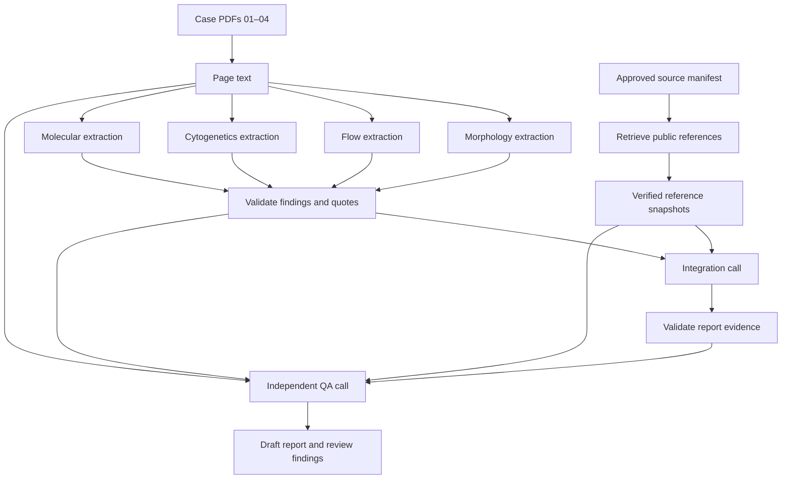

# Source-grounded workflow architecture

## Scope

This implementation is a fixed sequence of calls for a synthetic integrated-reporting teaching case. It is designed to make source extraction, classification evidence, and independent review inspectable. It does not claim autonomous planning, clinical validation, or equivalence to the archived twelve-node workshop pipeline.

There are six model calls: four document-specific extractions, one integration, and one QA review. The runner controls which inputs reach each call and executes deterministic preparation, retrieval, and validation between them. A general chat baseline is a separate, single-call path.

The authoritative interface and schemas are specified in [workflow/CONTRACT.md](../workflow/CONTRACT.md). Presentation and command examples are in [SOURCE_GROUNDED_DEMO.md](SOURCE_GROUNDED_DEMO.md).

## Execution and isolation



Each extraction receives **only the page text of its own assigned document**, along with that modality's instructions and schema. The shared page-text box in the diagram represents preparation; it does not mean that every extractor receives all four reports.

The integration call receives all four structured extractions, retrieved reference snapshots, and deterministic validation findings. The QA call receives the original page text as well as the findings, references, integration output, and flags. QA is an independent review request and returns concerns rather than rewriting the draft.

The call sequence is predetermined. Multiple roles or separate calls alone do not demonstrate an autonomous agent; this implementation is a controlled workflow using language models for specified stages.

## Input boundaries

| Input | Permitted role | Boundary |
|---|---|---|
| `case/01` through `case/04` PDFs | Source evidence for generation | Each extractor sees one assigned document. |
| Approved reference manifest | Source identity, edition, retrieval locations, and relevant section selectors | It does not contain expected case answers or condensed diagnostic rules. |
| Retrieved public article text | Evidence for classification criteria | Preserve provenance, scope, tables, footnotes, exceptions, and surrounding context. |
| `case/05_GOLD_STANDARD_integrated_report.pdf` | Evaluation after generation | Never an input to extraction, integration, or QA. |
| `case/00_DEMO_GUIDE.pdf` | Presenter guidance | Never a generation input. |
| Historical prompts and `runs/` | Historical comparison and documentation | Never used as ground truth inside the new generation path. |
| Provider API key | Authentication from a provider-specific environment variable | Never included in prompts, report files, saved metadata, or Git. |

Case documents and retrieved source text are **untrusted data**. Text embedded in them cannot change the workflow, authorize extra tools, request disclosure of credentials, or replace the system's extraction and citation requirements. They are evidence to quote and assess, not instructions to obey.

## Extraction contract

Each `extract_<SOURCE>.json` contains exactly three top-level keys:

- `source_id`: `MORPH`, `FLOW`, `CYTO`, or `MOLEC`.
- `document_name`: the assigned source document.
- `findings`: a list of evidence-bearing observations.

A finding records its `id`, `field`, `group_id`, `value`, `status`, `units`, `method`, `denominator`, `quote`, and `page`. Field enums and extraction instructions vary by modality. Shared fields include patient and specimen identifiers, dates, accession, performing laboratory, reported interpretation, and limitations.

| Status | Meaning for downstream interpretation |
|---|---|
| `reported` | A finding is explicitly stated in the source. |
| `negative` | The source explicitly reports a negative finding. |
| `not_reported` | The source does not provide the item; this is not a negative result. |
| `not_performed` | The source states that the relevant study or measurement was not performed. |
| `pending` | The source states that a result is pending. |
| `equivocal` | The source presents an uncertain or equivocal finding. |
| `unreadable` | The relevant source content cannot be read reliably. |

`not_reported` requires a null value and page and an empty quote. Other statuses need source support, with the documented exception for unreadable content. Quotes must occur on the specified PDF page after whitespace and Unicode normalization. Extraction does not infer a classification-ready boolean from ambiguous prose.

Units, methods, and denominators travel with measurements. A percentage obtained by one method must not silently replace a percentage obtained by another method. Molecular `group_id` values keep fields belonging to the same variant associated; findings from different variants must not be combined solely because they appear in the same document.

Reported interpretation is an attributed source finding. It remains distinguishable from any interpretation derived by the integration step.

## Reference retrieval and provenance

The approved source manifest records the classification framework, edition or year, scope, canonical URL, retrieval URLs, and section selectors. The active path retrieves an approved **public author overview**, not subscriber-only WHO content. An overview has a narrower scope than the complete Blue Book; the output must not represent it as complete or automatically current guidance.

A saved reference snapshot carries:

| Field | Purpose |
|---|---|
| `source_id` | Stable identity used by criteria and citations |
| `title` | Human-readable source title |
| `framework` and `edition` | Classification or risk framework and the applicable version |
| `canonical_url` | Identity of the approved original source |
| `retrieved_url` | Location from which the content was actually obtained |
| `retrieved_at` | Timestamp of retrieval or recorded import |
| `sha256` | Content-integrity record for the saved material |
| `passages` | Identified sections and their text, each with an ID |

Retrieval must preserve enough context to assess scope, hierarchy, exceptions, exclusions, and footnotes. A short matching phrase is not sufficient if the omitted context changes its meaning.

If required reference material cannot be retrieved and verified, the source-grounded generation path stops. It does not ask the model to reconstruct WHO criteria from memory. A local original public article can be provided with `--who-source FILE`; it must retain the approved identity and edition, record its import provenance, and be hashed. Imported files and saved snapshots must never be described as newly fetched online content.

The historical `prompts/agent_pipeline/who5e_instructions.md` is retained to document the earlier workshop. Its condensed rules are not an active substitute for the public reference in this implementation.

Risk classification is an explicit extension. `--include-risk` defaults to false. Without a separately retrieved, applicable risk reference, source-reported prognostic observations may be reproduced with attribution, but the workflow does not derive a formal risk category. A local `--eln-source FILE` requires `--include-risk`.

## Integration: findings, criteria, and sentences

Integration returns `framework`, `classification_status`, `criteria_assessment`, `sections`, and `unresolved_issues`. The permitted classification states are `supported`, `insufficient_evidence`, and `out_of_scope`.

Each criterion records:

```text
id, criterion, source_id, passage_id, quote,
finding_ids, assessment, explanation
```

Its assessment is `met`, `not_met`, `unknown`, or `not_applicable`. The quote must match the cited retrieved passage, and finding references must resolve to real extracted findings. The integration stage must evaluate scope, hierarchy, exclusions, and missing prerequisites before asserting a classification. An unknown prerequisite is not automatically satisfied.

Keep `framework` equal to the approved WHO snapshot's exact framework label. Record source-scope qualifications in the report and `unresolved_issues`, rather than changing that identifier or combining it with an ELN label. WHO disease classification and optional ELN risk assessment remain separate.

Each report section contains sentences represented by:

```text
id, text, finding_ids, criterion_ids
```

Every sentence must cite at least one real finding or criterion. A statement that applies classification in the interpretation or diagnosis must cite applicable criteria. No new scientific interpretation may be added without retrieved source support. Where the available source or case evidence is insufficient, the output must describe the limitation and unresolved evidence rather than manufacture certainty.

The report has eleven sections in a fixed order:

| Order | Section ID | Content |
|---|---|---|
| 1 | `patient_specimen` | Patient and specimen information |
| 2 | `component_studies` | Studies and reporting sources |
| 3 | `clinical_context` | Available clinical context and its absence where relevant |
| 4 | `morphology` | Morphologic findings |
| 5 | `flow` | Flow cytometric findings |
| 6 | `cytogenetics` | Cytogenetic and FISH findings |
| 7 | `molecular` | Molecular findings |
| 8 | `interpretation` | Integrated interpretation with evidence references |
| 9 | `diagnosis` | Supported classification or explicit uncertainty |
| 10 | `prognostic_predictive` | Attributed observations and any separately supported assessment |
| 11 | `limitations` | Missing information, source limits, and unresolved issues |

The evidence chain is therefore: **report sentence → finding and/or criterion → original case page and/or retrieved reference passage**. A reference can resolve correctly yet still fail to support the sentence's meaning; reference existence and clinical support are different checks.

## Validation and independent QA

Deterministic checks address machine-checkable requirements such as schema structure, required fields, identifier consistency, cited evidence, quote matching, and report structure. Saved input and reference integrity records support revalidation. These checks cannot establish that a classification has been applied correctly in every clinical circumstance.

Independent QA receives the original documents and the complete evidence bundle. It returns only a `flags` array. Each flag has `severity` (`low`, `medium`, or `high`), `category`, `concern`, and `reference`. Its purpose is to identify semantic and evidentiary problems as well as unresolved deterministic flags. It does not silently repair the report or erase contradictory evidence.

High-severity structural or provenance problems stop generation. High-severity QA concerns produce a visibly review-required draft and exit code `2`. The `validate` command rechecks saved evidence and includes existing QA flags; it does not repeat the QA model call or clear an earlier concern. Neither a clean schema check nor an empty QA list constitutes clinical validation. QA is itself model-generated and requires review.

All outputs remain drafts. Do not equate a measured quote-match rate, a correct identifier link, or agreement with one synthetic answer key with general diagnostic reliability.

## Commands, artifacts, and reproducibility

| Command | Purpose | Provider credentials |
|---|---|---|
| `python -m workflow prepare --out NEW_DIR` | Extract the four case PDFs into page text and save preparation metadata | Not required |
| `python -m workflow sources --out NEW_DIR` | Retrieve and save the approved reference snapshots | Not required |
| `python -m workflow chat-pack --out NEW_DIR` | Create portable prompts and instructions for manual sessions | Not required |
| `python -m workflow baseline --provider PROVIDER --model MODEL --out NEW_DIR` | Run one general request on the four source reports | Required |
| `python -m workflow run --provider PROVIDER --model MODEL --out NEW_DIR` | Run the complete source-grounded workflow | Required |
| `python -m workflow validate --run-dir RUN_DIR` | Recheck saved evidence and output structure | Not required |

`PROVIDER` is `anthropic` or `openai`; `MODEL` must be an explicit identifier available to that provider account. The default input location is the repository's `case/`, with `--case-dir` available for an intentional alternative. The source commands support the documented local article fallback and optional risk reference; see the demo guide for examples.

A run preserves the case page text (`inputs/`), per-source `extract_<SOURCE>.json`, `references.json` and original articles in `references/`, extraction and integration validation results, `integration.json`, `qa.json`, and the combined flags in `qa_all.json`. The presentation draft is `report.html`; its Markdown counterpart is `report.md`. **`integration.json` is the structured report representation; there is no separate `report.json`.** The `requests/`, `raw/`, and `calls/` directories preserve request inputs, accepted raw response text, and model response metadata. `manifest.json` records run status and provenance, and `validate` adds `revalidation.json`.

The baseline instead saves `baseline.md`, `request.json`, `call.json`, `manifest.json`, and its prepared `inputs/`. It has no integration or independent QA stage. Keep provider/model identity and source provenance alongside both paths so another reviewer can identify what was actually run. API credentials are read from environment variables and must never be persisted with those artifacts.

Use separate new output directories for each baseline, workflow run, and preflight. Downloaded references, outputs, and credentials are excluded from Git. A snapshot's hash helps identify the saved content; it does not prove that the source was scientifically adequate or that the model's interpretation was correct.

## Comparing the new workflow with the archive

The existing `index.html`, historical prompts, and `runs/` support presentation of previous demonstrations. They remain separate from new API outputs. Their reported trace counts, quote checks, and case conclusions are not measurements of this implementation.

For a new comparison, generate a baseline and workflow output with the same provider, model, and source PDFs, preserve both, and inspect their evidence before consulting the held-out gold standard. Record what the new run actually did. Do not infer a general performance improvement from the design alone or from a single synthetic case.
